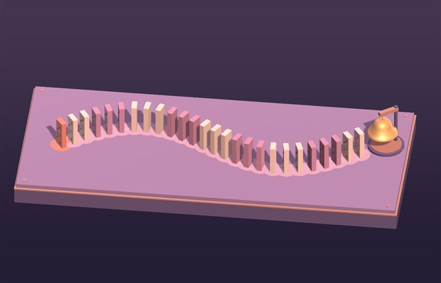

# Темы МИРЫ

Прототипы на Rust/egui, собранные Полли, Ирис и командой Garden.
[Атлас Ирис в Notion](https://app.notion.com/p/42049fda329681908945dba88acdd3c1)
хранит сценарии пробы, тиры и допуск. Тир — оценка Лилии, допуск — переносимость
целого стиля по шкале 1–6.

## Открыть

Команды выполняются из корня Avilon.

```powershell
cargo run --offline --locked -p avilon-mira-showcase --bin mira-atlas
cargo run --offline --locked -p avilon-mira-showcase --bin mira-settings
cargo run --offline --locked -p avilon-mira-showcase --bin mira-settings -- --compact
```

Атлас открывает одиннадцать интерфейсов из одного окна. Во вкладке «Графика»
собраны примеры типографики и вкладок. Во вкладке «Анимация» стрелки листают
интерактивные опыты. Галерея запускает сцены Bevy и Unity из отдельных сборок.
Есть и прямой запуск, например:

```powershell
cargo run --offline --locked -p avilon-mira-showcase --bin mira-atlas -- --style kalka
```

## Анимация и игровые прототипы

В «Объёмной призме» можно менять форму, освещение, цвет и скорость вращения.
Семь форм используют один код проекции и отрисовки граней. В «Живой гравюре»
штрихи плавно прогибаются от указателя. [Исходник анимаций](showcase/src/animation.rs).

| Наклонный сад | Площадь от рассвета до ночи | Дорожка домино |
| --- | --- | --- |
|  |  |  |
| Наклоняй поднос и направь шарик к лунке. | Поверни диск и проследи, как двигаются тени и загораются окна. | Толкни первую плашку и дождись звонка. |

Исходники трёх сцен лежат в [проекте Unity](../../experiments/unity-kinetka).
Версия редактора указана в [ProjectVersion.txt](../../experiments/unity-kinetka/ProjectSettings/ProjectVersion.txt).
Открой сцены **Tilt Garden**, **Clock Square** и **Domino Run** из папки
`Assets`. Для сборок Windows, которые atlas запускает из карточек, используй
методы `TiltGardenBuild.AssembleAndBuild` и `KinetkaScenes.VerifyAndBuild`
в `Assets/Editor`. Они записывают сборки в `target` в корне Avilon.
Деревья и камни из Kenney Nature Kit идут с [лицензией CC0](../../experiments/unity-kinetka/Assets/Kenney%20Nature%20Kit/License.txt).

Для «Театра света» собери [демо Bevy](../../experiments/bevy-light) из корня Avilon:

```powershell
cargo build --locked --manifest-path experiments/bevy-light/Cargo.toml --target-dir target/bevy-light
```

## Начать новый интерфейс

1. Для полноразмерного окна взять **Вёрстку**. Для короткого поиска или окна
   команд взять **Люмен**. Обе компоновки есть в
   [avilon_egui::mira](../../crates/avilon-egui/src/mira.rs). Подключить
   `avilon-egui` как зависимость и использовать `mira::workspace` или
   `mira::launcher` в своём `eframe::App`. Состояние, данные и обработчики
   передаёт приложение.
2. Вставить живой сценарий ядра в рабочую область. Для строк настроек брать
   `settings_layout::SettingsRow`, для поиска и навигации в палитре —
   `avilon_actions::palette`. [Настройки утилиты](showcase/src/bin/mira-settings.rs)
   используют это вместе: два раздела, рабочий поиск команд, изменение параметров,
   применение и отмену в памяти окна.
3. Подключить нужный приём из таблицы. `mira::Theme` даёт десять визуальных
   пресетов для обычных egui-виджетов. Композиция и особый жест каждого исходного
   окна видны в соответствующем исходнике. Для их переноса адаптировать отрисовку
   и входные данные к задаче приложения.
4. Проверить рабочий сценарий, клавиатурный фокус и узкое окно. Ирис помогает
   выбрать направление и принять дизайн в реальном приложении.

```toml
[dependencies]
avilon-egui = { path = "C:/Avilon/crates/avilon-egui" }
```

Пресеты рассчитаны на `egui = "=0.36.2"`. Приложение выбирает и загружает
шрифты. Пример использует установленную Georgia для «Вёрстки» на Windows и
стандартный шрифт egui при её отсутствии.

## Шаблоны

| Стиль | Исходник | Какой приём переносить |
| --- | --- | --- |
| Вёрстка | [verstka](showcase/src/verstka.rs) | Ясная типографика, индекс и большая рабочая область. |
| Люмен | [lumen](showcase/src/lumen.rs) | Компактный поиск, быстрый выбор и обзор результата. |
| Контакт | [contact](showcase/src/contact.rs) | Кинолента и сравнение двух объектов рядом. |
| Азимут | [azimuth](showcase/src/azimuth.rs) | Переключение разделов и объектов по двум осям. |
| Гербарий | [herbarium](showcase/src/herbarium.rs) | Свободный холст, перетаскивание карточек, связи и инспектор. |
| Пульт | [pult](showcase/src/pult.rs) | Ручки, приборные клавиши и горизонтальная навигация в отсеке действий. |
| Орбита | [orbit](showcase/src/orbit.rs) | Круг контекстных действий у указателя и его клавиатурный вариант. |
| Ложа | [lozha](showcase/src/lozha.rs) | Архитектурная рамка, тонкие линии и смена освещения. |
| Калька | [kalka](showcase/src/kalka.rs) | Два слоя, перетаскиваемый сгиб, регулировка просвета. |
| Семафор | [semaphore](showcase/src/semaphore.rs) | Последовательность как маршрут, команды как указатели на той же линии. |
| Nolox | [nolox](showcase/src/nolox.rs) | Карта зависимостей, световые фазы и гранёные узлы, которые показывают состояние задачи. |

Nolox показывает очередь сборки на вымышленных данных. Для переноса в рабочее
приложение передайте карте задачи, связи и прогресс из своего ядра. Эффекты
рисуются средствами egui. Идея выросла из визуального разбора уровня Nolox
в Geometry Dash. Графика окна и компоновка созданы для Миры.

## Происхождение и проверка

В `showcase` перенесены исходники проекта Mira и встроенные изображения
вымышленной коллекции «После дождя». Шесть изображений сгенерированы для
прототипа. Превью в атласе — скриншоты работающих окон. Системные шрифты
считываются на устройстве пользователя. Исходники распространяются под MIT
согласно лицензии Avilon. Пример настроек добавлен в Avilon и работает с
состоянием в памяти. Потребитель подключает собственное ядро и хранение настроек.

```powershell
cargo test --offline --locked --workspace --all-features --all-targets -j2
python -B scripts/verify-materials.py
```
